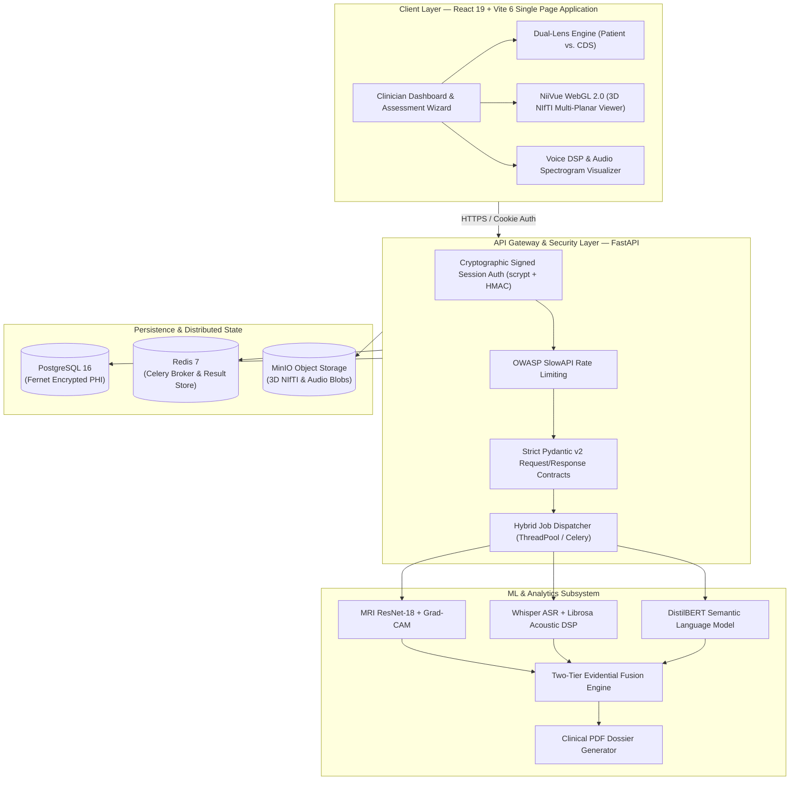

<div align="center">

  

  # NeuroSense AI

  ### Multimodal Early Alzheimer's Detection & Clinical Decision Support Workspace

  An investigational translational AI platform fusing 3D Brain MRI neuroimaging, acoustic voice DSP, linguistic speech NLP, cognitive psychometrics, and structured hazard profiling into an explainable clinical decision-support dossier.

  <br />

  [](https://neurosense.duckdns.org/)
  [](https://github.com/saurabhrdj50/neurosense-ai/actions)
  [](LICENSE)

  <br />

  [](https://www.python.org/)
  [](https://fastapi.tiangolo.com/)
  [](https://react.dev/)
  [](https://vitejs.dev/)
  [](https://tailwindcss.com/)
  [](https://www.docker.com/)
  [](https://www.postgresql.org/)
  [](https://www.w3.org/WAI/standards-guidelines/wcag/)

  <br />

  [**🚀 Launch Live Demo**](https://neurosense.duckdns.org/) &nbsp;•&nbsp;
  [**✨ Core Features**](#-core-capabilities) &nbsp;•&nbsp;
  [**🏗️ Architecture**](#️-system-architecture) &nbsp;•&nbsp;
  [**🧠 Multimodal Fusion**](#-two-tier-hybrid-fusion-engine) &nbsp;•&nbsp;
  [**⚡ 1-Click Quickstart**](#-quickstart-with-docker-compose) &nbsp;•&nbsp;
  [**🧪 Test Suites**](#-testing--quality-gates)

</div>

<br />

> [!TIP]
> **Live Clinical Cloud Workspace**: Access the live, fully-functional deployment at [**https://neurosense.duckdns.org/**](https://neurosense.duckdns.org/) — hosted on AWS EC2 with automated SSL/TLS termination via Caddy.

> [!IMPORTANT]
> **Investigational Clinical Decision Support Tool — Non-Diagnostic Research Scope**
> NeuroSense AI is an academic research platform and investigational Clinical Decision Support (CDS) instrument. It is **NOT** an FDA-cleared, CE-marked, or clinically validated diagnostic device.
> * All model predictions, stage classifications, risk indexes, and saliency maps represent experimental screening indicators.
> * Outputs must never supersede certified physician judgment, standard neurological workups, laboratory testing, or histological evaluations.

---

## 🌟 Overview

**NeuroSense AI** addresses the challenge of early, pre-symptomatic Alzheimer’s disease identification by combining orthogonal biomarkers into a single evidential assessment. Rather than relying on a solitary modality, NeuroSense AI deploys a **Two-Tier Hybrid Fusion Architecture**:

```
 3D Brain MRI (NIfTI) ────────┐
 Acoustic Vocal DSP  ──┐      │
                       ├──► [ Tier 1: Gated Speech ] ──┐
 Linguistic NLP      ──┘                               ├──► [ Tier 2: Attentive Fusion ] ──► Consensus Evaluation &
 Cognitive Battery (MMSE) ─────────────────────────────┤                                      Epistemic Uncertainty (σ²)
 Clinical Hazard Profiler ─────────────────────────────┘
```

1. **3D Brain MRI Volumetrics & Saliency**: ResNet-18 volumetric classification across 3 classes (`CN`, `MCI`, `AD`) paired with an interactive WebGL 2.0 multi-planar viewer (Axial, Coronal, Sagittal, 3D Raycast) and real-time Grad-CAM saliency overlays.
2. **Acoustic Voice DSP**: Autonomous digital signal processing measuring pitch stability ($F_0$), local jitter (%), local shimmer (%), harmonics-to-noise ratio (HNR), and formants ($F_1, F_2$) to detect subtle motor speech dysprosody.
3. **Linguistic Speech NLP**: On-device Whisper transcription feeding a 768-dimensional DistilBERT semantic pipeline to identify lexical richness erosion (TTR), syntactic complexity shifts, and hesitation pauses.
4. **Digital Cognitive Screening**: Interactive 6-domain psychometric examination (Orientation, Memory, Attention, Recall, Language, Visuospatial) providing granular domain breakdown.
5. **Clinical Hazard Engine**: Quantitative scoring of 18 cardiovascular, genetic (APOE4), metabolic, and lifestyle risk factors.

---

## ✨ Core Capabilities

### 🩺 Dual-Lens Diagnostic Presentation
Different stakeholders need different levels of clinical detail. NeuroSense AI provides an instant, zero-recalculation toggle:
* **Patient & Family Summary**: Empathetic, jargon-free explanations using clear visual analogies, lifestyle risk guidance, and structured questions to ask their primary care physician.
* **Clinician Workstation (CDS)**: Comprehensive technical telemetry including individual modality likelihoods, epistemic uncertainty ($\sigma^2$), cross-modality agreement indexes, Grad-CAM attribution heatmaps, and downloadable formal clinical PDF dossiers.

### 🔬 Multi-Planar NIfTI & Grad-CAM Inspector
* Zero-footprint client-side rendering via **NiiVue WebGL 2.0**.
* Live slider control for Grad-CAM overlay opacity ($0\% - 100\%$) and selectable diagnostic colormaps.
* Orthogonal multi-slice synchronization with crosshair tracking across volumetric datasets.

### 🛡️ Clinical Verification Safety Gate
* Pre-analysis clinical sign-off gate requiring explicit attending clinician verification of patient identity and intake data before computational inference is unlocked.

### ♿ WCAG 2.2 AA Accessibility & Responsive Precision
* Minimum touch targets $\ge 44 \times 44\text{px}$ across all interactive controls.
* High-contrast focus rings (`focus-visible:ring-2`) with zero clipping.
* Strict screen-reader semantic trees and responsive layouts tested across 375px, 768px, 1024px, and 1440px viewports with zero horizontal overflow.

---

## 📊 Multimodal Screening Modalities

| Modality | Input Types | Underlying AI / DSP Pipeline | Clinical Telemetry & Explainability |
| :--- | :--- | :--- | :--- |
| **Brain MRI** | 3D NIfTI volumes (`.nii`, `.nii.gz`) or 2D image slices | Fine-tuned **ResNet-18** CNN on ADNI lineage (`CN`, `MCI`, `AD`) + **Grad-CAM** | Interactive Axial, Coronal, Sagittal & 3D raycast rendering; activation heatmap opacity blending. |
| **Acoustic Voice DSP** | Audio files (`WAV`, `WebM`, `MP3`) or live microphone | **Autonomous DSP Pipeline** (Librosa / OpenSMILE eGeMAPS) | Pitch $F_0$, Jitter %, Shimmer %, HNR (dB), Formants ($F_1, F_2$), and Composite Vocal Risk Index ($0-100$). |
| **Speech NLP** | Audio speech or typed clinician transcript | **Whisper ASR** (`faster-whisper`) + **DistilBERT** 768-dim embeddings | Type-Token Ratio (TTR), speech pausometry, pronoun-to-noun shift, and linguistic dementia likelihood $P(\text{dementia})$. |
| **Cognitive Battery** | Interactive digital questionnaire | 6-domain psychometric scoring (Orientation, Calculation, Recall, etc.) | Domain vulnerability breakdown, composite score ($0-100$), and MMSE stage mapping. |
| **Clinical Risk Profiler** | Structured medical intake form | Weighted multivariable hazard model (18 risk parameters) | Relative cardiovascular/lifestyle hazard index ($0-100$) and targeted preventive recommendations. |
| **Hybrid Fusion Engine** | Unified active stream inputs | **Two-Tier Evidential Attention** with missing-modality compensation | Unified consensus stage, Modality Agreement Index, Epistemic Uncertainty Variance ($\sigma^2$), and contribution weights. |

---

## 🏗️ System Architecture



---

## 🧠 Two-Tier Hybrid Fusion Engine

The evidential multimodal fusion engine ([`backend/app/ml/fusion/engine.py`](backend/app/ml/fusion/engine.py)) operates across two hierarchical tiers:

```
┌─────────────────────────────────────────────────────────────────────────────────┐
│                      Tier 1: Cross-Modal Speech Gating                          │
│                                                                                 │
│   Acoustic Dysprosody Indicators          DistilBERT Linguistic Semantics       │
│  (Jitter, Shimmer, HNR, Formants)               (768-dim Embeddings)            │
│               │                                          │                      │
│               └──────────────────► GATING ◄──────────────┘                      │
│                                      │                                          │
│                                      ▼                                          │
│                          Contextual Speech Score                                │
└──────────────────────────────────────┬──────────────────────────────────────────┘
                                       │
                                       ▼
┌─────────────────────────────────────────────────────────────────────────────────┐
│                 Tier 2: Attentive Evidential Decision Fusion                    │
│                                                                                 │
│   Brain MRI      Contextual Speech      Cognitive Battery      Clinical Risk    │
│  (ResNet-18)      (Tier 1 Fusion)            (MMSE)             (18 Hazards)    │
│   W_base=0.40       W_base=0.35            W_base=0.15          W_base=0.10     │
│       │                  │                      │                    │          │
│       └──────────────────┴──────────┬───────────┴────────────────────┘          │
│                                     │                                           │
│                 Dynamic Confidence Attention Scaling:                           │
│                 α_k = W_k · [1.0 + 0.25 · (Confidence_k - 0.5)]                 │
│                                     │                                           │
│                 Dynamic Missing Modality Re-Normalization:                      │
│                 Active weights scaled to sum strictly to 1.0                    │
│                                     │                                           │
│                                     ▼                                           │
│     ┌─────────────────────────────────────────────────────────────────────┐     │
│     │ Consensus Stage (CN / MCI / Mild Dementia / Moderate Dementia)      │     │
│     │ Agreement Index: Full | High | Moderate | Low                       │     │
│     │ Epistemic Uncertainty Variance: σ² across active inputs             │     │
│     └─────────────────────────────────────────────────────────────────────┘     │
└─────────────────────────────────────────────────────────────────────────────────┘
```

---

## 🚀 Quickstart with Docker Compose

The entire stack (**Web SPA, FastAPI, Celery ML Worker, PostgreSQL 16, Redis, MinIO**) can be launched with a single command:

```bash
# 1. Clone the repository
git clone https://github.com/saurabhrdj50/neurosense-ai.git
cd neurosense-ai

# 2. Configure environment variables
cp backend/.env.example backend/.env

# 3. Build and launch all containers
docker compose up --build
```

### 🌐 Service Port Matrix

| Service | Access Endpoint | Description |
| :--- | :--- | :--- |
| **Live Production Cloud** | [https://neurosense.duckdns.org/](https://neurosense.duckdns.org/) | Live AWS EC2 deployment with automated HTTPS |
| **Local Web Application** | [http://localhost:3000](http://localhost:3000) | React 19 Frontend (Served via Nginx / Vite) |
| **Backend REST API** | [http://localhost:10000](http://localhost:10000) | FastAPI Core Backend |
| **Interactive API Docs** | [http://localhost:10000/docs](http://localhost:10000/docs) | Swagger UI OpenAPI Explorer |
| **MinIO Console** | [http://localhost:9001](http://localhost:9001) | S3 Object Storage Browser |
| **PostgreSQL 16** | `localhost:5432` | Relational Storage (`postgres:16-alpine`) |
| **Redis 7** | `localhost:6379` | Celery Broker & In-Memory Cache |

---

## 🧪 Testing & Quality Gates

Every code change must satisfy our automated quality gates across unit, integration, and cross-device browser testing.

<div align="center">

| Test Suite | Framework | Target Scope | Passing Status |
| :--- | :--- | :--- | :---: |
| **End-to-End Browser QA** | Playwright | Full clinical walkthrough across 4 viewports (375px, 768px, 1024px, 1440px) | **16 / 16 Passed (100%)** |
| **Backend API & Security** | Pytest | Authentication, Rate limiting, Session cookies, PHI encryption, Celery tasks | **61 / 61 Passed (100%)** |
| **Frontend Unit & Logic** | Vitest | Clinical mappers, DSP biomarker calculators, Dual-Lens toggles, XAI attribution | **41 / 41 Passed (100%)** |
| **Frontend Static Quality** | ESLint | Code style, React 19 hooks, Accessibility rules, Dead-code prevention | **0 Errors, 0 Warnings** |
| **Production Build** | Vite 6 | Type-check, CSS purge, PWA manifest, Bundle minimization | **Zero Errors (4.85s build)** |

</div>

<br />

<details>
<summary><b>🔍 Click to view step-by-step test execution commands</b></summary>

```bash
# 1. Run Playwright End-to-End Suite (Multi-Viewport Responsive QA)
cd frontend
npm run e2e

# 2. Run Frontend Unit & Integration Tests
cd frontend
npm test

# 3. Run Frontend Linter
cd frontend
npm run lint

# 4. Run Backend Pytest Suite
cd backend
source venv/bin/activate
pytest tests/test_api.py tests/test_auth.py tests/test_audit_fixes.py

# 5. Execute Production Vite Build
cd frontend
npm run build
```

</details>

---

## 💻 Bare-Metal Development Setup

<details>
<summary><b>🛠️ Click to expand instructions for manual setup without Docker</b></summary>

### Prerequisites
* **Python**: `3.11` or higher
* **Node.js**: `20.x` or higher (`npm 10+`)
* **Git**

### 1. Backend Service Setup
```bash
cd backend

# Create and activate Python virtual environment
python3 -m venv venv
source venv/bin/activate    # On Windows: venv\Scripts\activate

# Install dependencies
pip install -r requirements.txt

# Start backend (defaults to SQLite if PostgreSQL is not active)
python run.py
```
*API available at [http://localhost:10000](http://localhost:10000) (Swagger docs at `/docs`).*

### 2. Frontend SPA Setup
In a separate terminal window:
```bash
cd frontend

# Install Node dependencies
npm install

# Start Vite development server
npm run dev
```
*Web client available at [http://localhost:3000](http://localhost:3000) with live proxying to backend on port 10000.*

</details>

---

## 🔐 Security, Privacy & HIPAA Compliance Safeguards

1. **Protected Health Information (PHI) Encryption**: Patient identifiers, names, and contact records are encrypted at rest using **Fernet 128-bit AES-CBC** cryptography with dedicated key management.
2. **Cryptographic Authentication**: Passwords hashed using memory-hard **scrypt** with unique salt derivations per user.
3. **Signed Session Cookies**: HTTP-only, SameSite cookies signed with HMAC-SHA256 prevent token theft and cross-site scripting (XSS) compromise.
4. **OWASP Defense-in-Depth**: Strict SlowAPI rate limiting protects authentication and heavy inference endpoints from denial-of-service and credential stuffing.
5. **Immutable Audit Trails**: Structured audit logs track all clinician logins, patient creation events, and assessment submissions.

---

## 📂 Repository Organization

```
neurosense-ai/
├── backend/                          # FastAPI REST API & Machine Learning Backend
│   ├── alembic/                      # Database schema migrations & version scripts
│   ├── app/                          # Core application package
│   │   ├── api/routes/               # REST routes: auth, patients, analysis, history, admin
│   │   ├── config/settings.py        # Centralized Pydantic application settings
│   │   ├── features/                 # Business domain features & orchestration
│   │   ├── ml/                       # Machine learning inference subsystem:
│   │   │   ├── mri/                  # ResNet-18 model, NIfTI volumetric loader, Grad-CAM
│   │   │   ├── speech/               # Whisper ASR, Acoustic DSP Biomarkers, DistilBERT NLP
│   │   │   ├── cognitive/            # Neuropsychological test scoring & MMSE mapping
│   │   │   ├── risk/                 # 18-hazard cardiovascular & genetic profiler
│   │   │   ├── fusion/               # Two-Tier Hybrid Multimodal Fusion Engine
│   │   │   └── reporting/            # Automated clinical PDF report generator
│   │   ├── shared/                   # Core DB ORM, MinIO storage, Security, Validation
│   │   ├── tasks/                    # Celery asynchronous task definitions
│   │   └── celery_app.py             # Celery Redis application configuration
│   ├── tests/                        # Comprehensive Pytest suite (Auth, API, Audit Fixes)
│   ├── Dockerfile                    # Multi-stage production container build
│   └── requirements.txt              # Backend Python dependencies
├── frontend/                         # React 19 + Vite 6 Single Page Application & PWA
│   ├── e2e/                          # Playwright end-to-end tests (app.spec.js, responsive.spec.js)
│   ├── src/                          # Application source code
│   │   ├── features/analysis/        # 6-step clinical assessment wizard
│   │   ├── features/dashboard/       # Clinical triage dashboard, cohort trajectories & dossiers
│   │   ├── features/results/         # Diagnostic workspaces: NiiVue 3D MRI, Speech, XAI
│   │   ├── features/patients/        # Patient directory, registration, search
│   │   ├── features/history/         # Longitudinal timeline & PDF download
│   │   ├── shared/                   # Design system primitives, clinical mappers, motion
│   │   └── providers/                # Theme, authentication, and TanStack query providers
│   ├── public/                       # PWA manifests, icons, static assets
│   ├── Dockerfile                    # Production Nginx frontend container
│   ├── nginx.conf                    # Nginx reverse proxy & caching configuration
│   └── package.json                  # Frontend dependencies and scripts
├── design-system/                    # Design tokens & specifications generated via ui-ux-pro-max
├── docker-compose.yml                # Multi-service production orchestration
├── UI_UX_TRANSFORMATION.md           # Engineering & clinical QA audit ledger
└── README.md                         # Main repository guide & documentation
```

---

## 📜 Clinical Research Disclaimer & License

NeuroSense AI is distributed under the **MIT License**. See [`LICENSE`](LICENSE) for complete terms.

```
Investigational Research Platform — Not for Autonomous Clinical Diagnosis.
Designed for translational machine learning research, clinical AI validation studies, and medical education.
```

<div align="center">
  <sub>Built with ❤️ for neurological health advancement and accessible clinical AI research.</sub>
</div>
